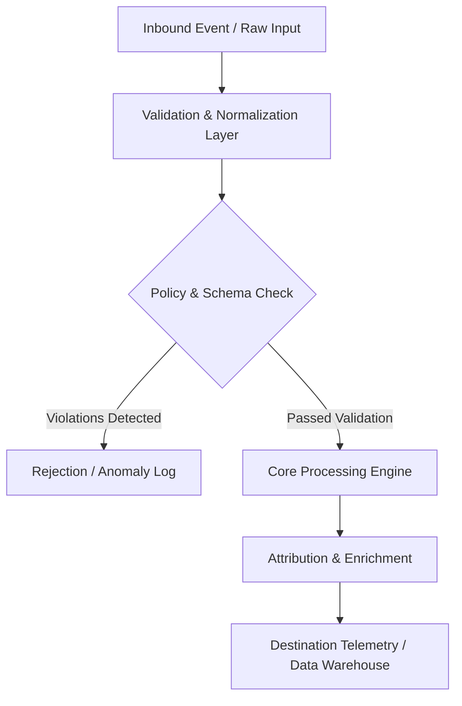

# Four Phase Blueprint

## Architecture Specification: Ramadan & Seasonal Retail Campaign Flighting Playbook
This document defines the technical architecture and event flow for **Ramadan & Seasonal Retail Campaign Flighting Playbook** within the **media-buying** domain.

### Operational Context
Create an authoritative Ramadan and Eid marketing campaign flighting framework: 1) 4-phase campaign blueprint (Pre-Ramadan warming, Mid-Ramadan engagement, Late-Ramadan gifting rush, Post-Eid clearance), 2) Mathematical budget allocation model (15% - 25% - 45% - 15%), 3) Dayparting bid scheduling rules for nighttime shopping spikes, 4) Real-world creative messaging matrix per phase.

---

## System Architecture & Data Flow

## Functional Components

### 1. Ingestion & Normalization Layer
- Captures raw telemetry, webhooks, or file exports.
- Strips whitespace, normalizes regional casing, and sanitizes phone numbers and email strings into E.164 and SHA-256 formats.

### 2. Processing & Business Logic Rules
- Applies deterministic rule engines or statistical models without external black-box dependencies.
- Handles missing or delayed event attributes using bounded lookback windows.

### 3. Output Delivery & Error Handling
- Returns structured JSON payloads with machine-readable error codes and status telemetry.
- Employs exponential backoff retry logic (3 attempts: 1s, 5s, 15s) for downstream webhook delivery.

---
*Operational standard maintained by @mahmoudabdelnaby1.*
